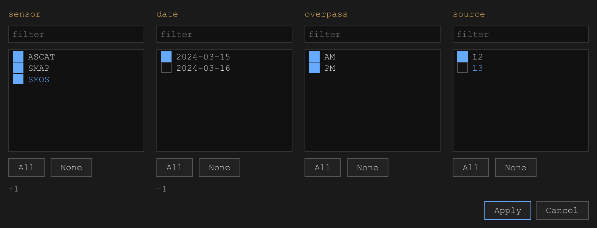

<p align="center">
  <picture>
    <source media="(prefers-color-scheme: dark)" srcset="https://raw.githubusercontent.com/ColinMoldenhauer/juxt/main/docs/assets/logo_large_transparent_dark.png">
    <source media="(prefers-color-scheme: light)" srcset="https://raw.githubusercontent.com/ColinMoldenhauer/juxt/main/docs/assets/logo_large_transparent.png">
    
  </picture>
</p>

# juxt

[](https://pypi.org/project/juxt/)
[](https://pypi.org/project/juxt/)
[](https://github.com/ColinMoldenhauer/juxt/actions/workflows/tests.yml)
[](https://juxt.readthedocs.io)
[](https://opensource.org/licenses/MIT)

juxt is a fast desktop tool for visually comparing plots across multiple parameter axes. Define axes (model, date, data source, ...) and flip through the resulting image hypercube with keyboard navigation.

*juxt* comes from *juxtapose* — placing things side by side to compare. That's the whole idea: flip through congruent plots fast enough to visually identify differences.

To check out the concept, [try the demo here](https://colinmoldenhauer.github.io/juxt/), no install needed.

## Install

Prebuilt binaries for Linux, Windows and macOS are on the [latest release page](https://github.com/ColinMoldenhauer/juxt/releases/latest). Download, unzip and run, no Python needed.

Alternatively, install from PyPI:

```
pip install juxt
```

This includes SSH support. The `test` and `docs` extras are for working on juxt itself, see the [development install](https://juxt.readthedocs.io/en/latest/installation/#development-install).

## Quick start

juxt takes one of several forms as its first argument. The local examples run as they are from a clone of this repository, on the sample plots in [`examples/`](https://github.com/ColinMoldenhauer/juxt/tree/main/examples):

```bash
juxt examples/sample_plots/                                               # auto-detect axes from a directory of images
juxt examples/sample_plots/{sensor}_{date}_{overpass}_{source}.png        # explicit local template
juxt examples/sample_plots_nested/*.png                                   # wildcard match, recursing into subdirs
juxt examples/sample_config.yaml                                          # explicit config file
juxt myhost:/data/sample_plots/                                           # remote directory over SSH
juxt myhost:/data/sample_plots/{sensor}_{date}_{overpass}_{source}.png    # remote template over SSH
```

Run `juxt` with no argument and it opens a dialog instead: a **Browse** tab for picking a directory (auto-discover), and a **Build path** tab for typing a `{placeholder}` template by hand, with `Tab` completing real directories and files along the way.

## Config

### Auto-discovery

Point juxt at a directory and it figures out the axes from the filenames:

```bash
juxt examples/sample_plots/
```

For directories, filenames are split on separators (`_` and `os.sep` by default, customize with `--sep`) and any position with more than one distinct value becomes an axis. You'll be prompted to name the axes; use `-a/--auto` to skip manual naming and assign dummy names.
All filenames must split into the same number of parts.


### Explicit templates

Provide named axes via python-style placeholder strings and juxt will discover the values.


```bash
juxt "examples/sample_plots/{sensor}_{date}_{overpass}_{source}.png"                     # use all autodetected axis values
juxt "examples/sample_plots/{sensor}_{date}_{overpass}_{source}.png" --sensor ASCAT SMOS  # restrict to a subset
```

Each axis can be constrained by passing a custom subset via its axis name `--NAME VALUE ...`.
juxt comes with tab-completion, type `--sensor <TAB>` to see possible values for the subset.


### Remote access (SSH)

juxt loads images from a remote host over SSH, transferring them with SFTP.
They are downloaded at startup and cached locally, so the next session only fetches what changed; navigation afterwards is identical to local use.
You pay the one-time loading cost upfront and then compare as fast as locally even on a slow connection.
Auth uses your SSH agent or `~/.ssh/config` key, with a password fallback.

Pass the remote path directly on the command line, and juxt detects the axes from the remote filenames:

```bash
juxt myhost:/data/sample_plots/
```

More in the [remote docs](https://juxt.readthedocs.io/en/latest/remote/).


### Predefined configs

Instead of re-typing a long juxt command every time, common comparisons can be pre-configured via YAML.

```yaml
# examples/sample_config.yaml
template: "examples/sample_plots/{sensor}_{date}_{overpass}_{source}.png"
axes:
  sensor:   [ASCAT, SMAP, SMOS]
  date:     [2024-03-15, 2024-03-16]
  overpass: [AM, PM]
  source:   [L2, L3]
keys:
  s: sensor
  d: date
  o: overpass
  r: source
```

The configs allow full control over pattern (auto-detection or template), axis and values, hotkeys, etc. See above example config which is equivalent to the above CLI call.
You can save a comparison to config from a running juxt window via the `:write` command.

See the [configuration docs](https://juxt.readthedocs.io/en/latest/configuration/#template-mode) for all options.

For the remote case, add the `remote` property to the config.
```yaml
remote: myhost               # or user@myhost, or user@myhost:port
template: "/data/sample_plots/{sensor}_{date}_{overpass}_{source}.png"
axes:
  sensor:   [ASCAT, SMAP]
    date:   [2024-03-15, 2024-03-16]
  overpass: [AM, PM]
  source:   [L2, L3]
```


## Navigation of Images

Default mode is **tap**. Each axis is assigned one letter key — tap it to step forward, hold Shift to step backward. Every navigation is a single keypress, no modifiers, no menus.

| Key | Action |
|---|---|
| `←` / `→` | cycle the primary axis |
| `↑` / `↓` | cycle the secondary axis |
| lowercase letter | navigate +1 on that axis |
| uppercase letter | navigate −1 on that axis |
| `Ctrl`+letter | open value picker for that axis |
| | (`modifiers.swap: true` exchanges the `Ctrl` and `Shift` roles) |
| `Space` | toggle between current and previous position |
| `Home` / `End` | jump to first / last value |
| `1`–`9` | jump to the Nth value |

If these bindings seem unintuitive to you, juxt implements two more modes. Use command `:mode tap|seek|pin` to switch navigation modes. The [navigation docs](https://juxt.readthedocs.io/en/latest/navigation/) describe each mode in detail. Further modes are experimental.

## Command mode

Press `:` to open the command bar (vim-style). Tab-completion narrows candidates as you type.

Matching is fuzzy: the characters you type only have to appear in order, so `:fh` reaches `fit-height` and `smp` finds `SMAP` in the value picker. Candidates are ranked best-first, prefix matches ahead of looser ones. Set `seek.fuzzy: false` in `~/.juxt/settings.yaml` for strict prefix matching.

Path arguments complete with `{placeholders}` in place: `:pattern examples/sample_plots_nested/{sensor}/⇥` lists what every sensor directory holds, so a template is built top-down instead of completing a concrete path and deleting the parts that should vary. `{` + `Tab` completes an existing axis name, and anonymous `{}` placeholders are numbered automatically.


## Adding and removing values

`:subset-interactive` opens a checklist of the values on disk for every axis, so a new run or sensor joins the session without restarting juxt.
Use command `:values AXIS`, or press the `[+]` next to an axis in the info sidebar.
`juxt PATH --subset-interactive` opens it at startup, before any image is read.



## Shell completion

The same completion works at the shell prompt. Add one line to `~/.bashrc`:

```bash
eval "$(juxt --bash-completion)"
```

zsh needs `bashcompinit` first:

```zsh
autoload -U bashcompinit && bashcompinit
eval "$(juxt --bash-completion)"
```

Then `juxt "examples/sample_plots_nested/{sensor}/⇥` completes at the prompt, as do the command-line options. Quote the template as shown if options follow it. An unquoted template runs fine, but bash 5.1 stops completing after an unquoted word with two or more placeholders, so the `--NAME` pins below would not complete. ble.sh is handled as well, through its own hook. Reload the shell (`source ~/.bashrc`, or open a new terminal) for it to take effect.

Point `JUXT_COMPLETE` at `juxt-complete` if juxt lives in a virtualenv you do not activate:

```bash
export JUXT_COMPLETE=~/env/juxt/bin/juxt-complete
```

Once the template is on the line, the options after it complete too. The placeholders become `--NAME` pin flags, and a pin's values are looked up on disk, narrowed by the pins already typed:

```
$ juxt "examples/sample_plots_nested/{sensor}/{overpass}/{date}_{source}.png" --sensor SMOS --source ⇥
L2  L3     # what exists under SMOS
```

Other parameters that are tab-completed:
`--axis-h`, `--axis-v` and `--grid`, `--grid-values` (the values of the `--grid` axis).
The lookup times out after half a second (`JUXT_COMPLETE_TIMEOUT=SECONDS` to change it) so a slow network share cannot freeze the prompt.


### Shorthands
We pre-define useful shorthands for common path components

| Placeholder | Matches |
|---|---|
| `date` | `yyyy-mm-dd`, `yyyy_mm_dd`, `yyyymmdd` |
| `datetime` | `yyyy-mm-ddThh:mm:ss`, `yyyy-mm-dd_hhmmss`, `yyyymmdd_hhmmss` |
| `time` | `hh:mm:ss`, `hh-mm-ss`, `hhmmss` |
| `year` | `yyyy` |
| `month` | `mm` |
| `day` | `dd` |
| `doy` | `ddd` (day of year) |

Shorthands can be configured as `placeholders:` in `~/.juxt/settings.yaml`.


## Commands

The vim-style command mode can be triggered by typing `:` (i.e. the colon).
Some commands

| Command | Action |
|---|---|
| `:q` | quit |
| `:fit` | fit image to window |
| `:fit height` / `:fit width` | fit to height or width |
| `:fit-off` | stop fitting, keep the current zoom |
| `:zoom N` | set zoom to N% |
| `:fullscreen` | toggle fullscreen |
| `:version` | show the juxt version (`juxt --version` from the shell) |
| `:mode tap\|seek\|pin` | switch navigation mode |
| `:grid [AXIS]` | tile an axis into a grid of viewports |
| `:grid AXIS VAL …` | grid with a value subset |
| `:keys` | toggle the shortcut sidebar (`Ctrl+Shift+K`) |
| `:grid-dialog` | open the grid builder dialogue (`Ctrl+Shift+G`) |
| `:grid-layout NxM` | change grid layout without exiting |
| `:grid-off` / `:ungrid` | return to single-image view |
| `:grid-sharex` / `:grid-sharey` | toggle synchronized pan/zoom |
| `:subset-interactive` | add or remove values of every axis in a checklist |
| `:values AXIS` | the same checklist for one axis |

To see all available commands, press `Ctrl+Shift+K` or run `:keys`.

## Controls

#### Zoom
| Key | Action |
|---|---|
| double-click | fit image to window |
| `0` | reset zoom to 100% |
| scroll wheel | step forward / backward on the primary axis |
| `Shift` + scroll wheel | step forward / backward on the secondary axis |
| `Ctrl` + scroll wheel | zoom (anchored under cursor) |
| drag | pan |

#### View
| Key | Action |
|---|---|
| `Enter` | toggle fullscreen |
| `Ctrl+Shift+C` | copy the current image path to the clipboard |
| right-click | menu: copy image path / copy image |
| `Ctrl+Shift+H` | toggle status bar  (start hidden with `--no-status-bar`) |
| `Ctrl+Shift+I` | toggle info sidebar  (starts open; `--no-info` or `sidebar.open: false` to change) |
| `Ctrl+Shift+K` | toggle shortcut sidebar  (start open with `--keys`) |
| `Ctrl+C` | copy the text selected in a sidebar  (otherwise cancels a command / value picker) |
| `Ctrl+Shift+G` | open the grid builder dialogue |


## Advanced CLI Features

A `*` in the path is matched recursively (unlike a shell glob, it reaches into nested subdirectories), and the matched files are split into axes the same way directory auto-detection is. Combine it with `--NAME VALUE ...` to pin a `{placeholder}` to a fixed set of directories and aggregate congruent files found under each:

```bash
juxt "{root}/*.png" --root examples/sample_plots_nested/ASCAT examples/sample_plots_nested/SMOS   # pool the congruent files found under both
```

If you'd rather have one *named* axis for an arbitrarily deep (and possibly differently-shaped) subtree, instead of it being auto-split into several anonymous axes, write `{**name}` in place of a regular placeholder. It captures across `/`, and any leading path segments shared by every match are pruned out of the axis value and folded into the template as fixed text, so `dir/AM/plot.png` and `dir/PM/plot.png` become axis values `AM/plot` and `PM/plot` rather than the full `dir/AM/plot`:

```bash
juxt "{root}/{**plot}.png" --root examples/sample_plots_nested/ASCAT examples/sample_plots_nested/SMOS   # one 'plot' axis (AM/2024-03-15_L2, ...), however deep it's nested
```

`{**name}` is limited to one per template (two independent `/`-crossing captures in one path would be ambiguous), and pass `--full-path` to see the whole matched path instead of the pruned suffix.
