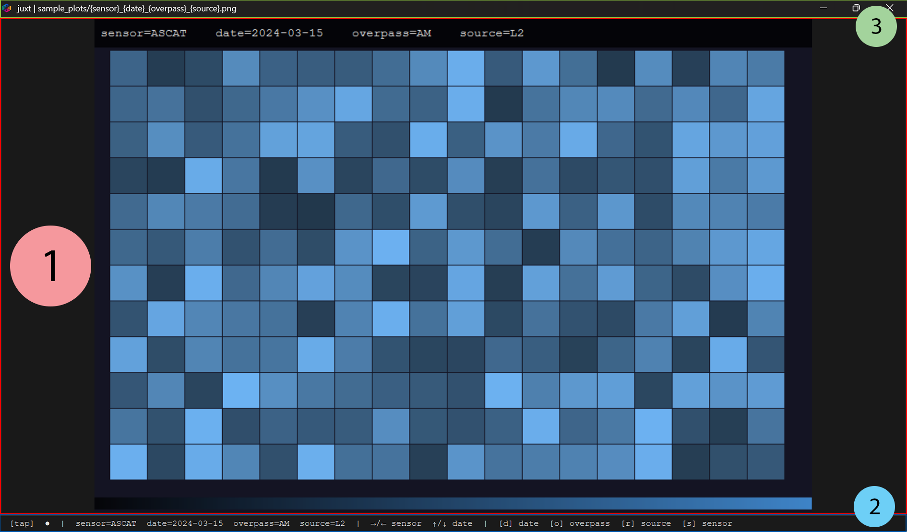
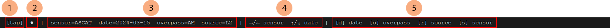
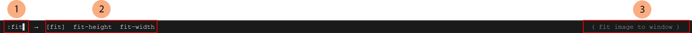
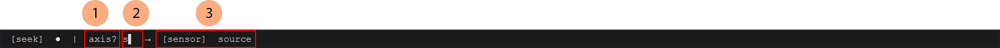
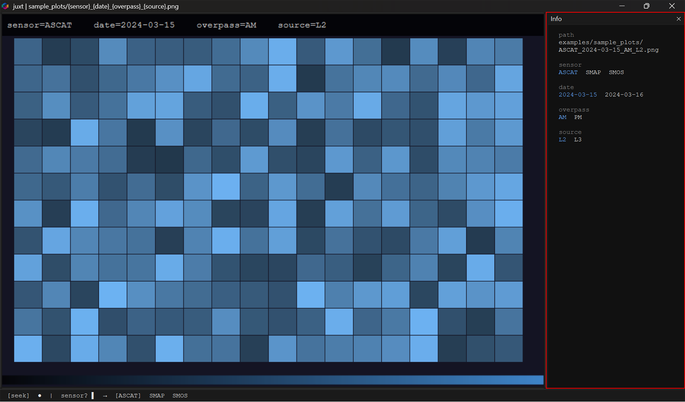
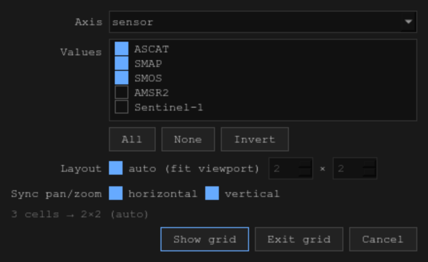

# UI overview

A quick tour of the juxt interface and its interactive elements.

---

## Main window



| # | Element | Description |
|---|---|---|
| 1 | **Image viewport** | Displays the current image. Drag to pan, scroll to zoom, double-click to fit, right-click for the copy menu. |
| 2 | **Status bar** | One-line summary of navigation state. Toggleable with `Ctrl+Shift+H`; auto-appears while command or value-picker is active. Shown at startup unless `--no-status-bar` is passed. |
| 3 | **Title bar** | Shows `juxt \| <session name>`. Without `--name` the session name is the template path, with your home directory written as `~` (a remote session leads with its host), followed by the values of any axes pinned with `--NAME VALUE ...`, e.g. `juxt \| ~/work/{filter}/{season}/{plot}.png [plot: stats, soc_violin]`. Anything past 100 characters is cut from the left, so the end of the path always shows. `--name` replaces all of it. |

---

## Status bar

### Normal



| # | Element | Description |
|---|---|---|
| 1 | **Mode** | `[tap]`, `[seek]`, or `[pin]` — the active navigation mode. |
| 2 | **Watch indicator** | `●` when live file-watching is active; absent otherwise. |
| 3 | **Axis values** | Current position in the hypercube, e.g. `sensor=ASCAT  date=2024-03-16`. |
| 4 | **Arrow bindings** | The primary (`←/→`) and secondary (`↑/↓`) axes, updated as you focus different axes. |
| 5 | **Letter assignments** | Which letter key navigates which axis. Axes without an available letter are shown in red. |

### Command mode



Triggered by pressing `:`.

| # | Element | Description |
|---|---|---|
| 1 | **Cursor** | The command being typed, e.g. `:fit▌`. In a free-text argument (`:pattern`, `:write`), each `{placeholder}` is coloured by position. |
| 2 | **Suggested values** | Fuzzy-matched command candidates, best match first; the selected entry is shown in `[brackets]` and coloured like the highlighted value in the info sidebar. After `Tab` on a path argument, this row lists the matching directory entries instead. |
| 3 | **Tooltip** | One-line description of the selected command, right-aligned. |

### Seek mode



Triggered by pressing any letter in seek mode. The same incremental search runs for both axis selection and value selection.

| # | Element | Description |
|---|---|---|
| 1 | **Prompt** | `axis?` while selecting an axis; `<axis-name> ›` while selecting a value on that axis. |
| 2 | **Cursor** | The query being typed. |
| 3 | **Candidates** | Matching axes or values, best match first; the current selection is shown in `[brackets]` and coloured like the highlighted value in the info sidebar. Matching is fuzzy — `smp` finds `SMAP` (`seek.fuzzy`) — and a lone candidate is confirmed automatically (`seek.greedy`); both live in `~/.juxt/settings.yaml`. |

---

## Info sidebar



Toggle with `Ctrl+Shift+I` or `:info`. The panel docks to the right of the viewport and lists all axes with their values; the active value on each axis is highlighted. The current path at the top always reserves as many lines as the longest path this config could ever show, so the axis list below it never shifts as you navigate — even though the actual path's own wrapped height varies from combination to combination.

Each axis header carries a `[+]`: click it to add or remove values of that axis from those found on disk, without restarting (see [`:values`](navigation.md#picking-values-from-disk-subset-interactive-values)).

Hovering the path shows what a click does. A click copies it to the clipboard (same as `:copy-path`); `Ctrl+click` (`Cmd+click` on macOS) shows the file in the system file manager (same as `:reveal`). Windows and macOS select the file in Explorer or Finder. On Linux the file is selected through the `org.freedesktop.FileManager1` D-Bus interface, which Nautilus, Dolphin, Nemo and Thunar offer; without it, the containing folder is opened instead. Remote (SSH) configs have no local file to reveal.

The `Copy CLI command` button at the bottom of the sidebar (or `:copy-cli-command`) copies a `juxt` command line that reopens the view as it is now. Every axis is pinned to its current values, so a selection made in the value picker, `:subset` or `:values` is repeated without any manual input next time; locked arrow axes and the grid view are included. The cursor position, custom key letters, the session name and an SSH port or key file cannot be expressed on the command line and are left out.

The sidebar starts open. Set `sidebar.open: false` in `~/.juxt/settings.yaml` to start with it closed; `--info` and `--no-info` override the setting for one run. The status bar is the mirror case: shown by default, hidden at startup with `--no-status-bar`.

```yaml
sidebar:
  open: true        # start with the info sidebar open
```

---

## Shortcut sidebar

Toggle with `Ctrl+Shift+K` or `:keys`, or open it at startup with `--keys`. The panel docks to the left of the viewport, opposite the info sidebar, so both can be open at once.

Everything it lists is read out of the running session rather than written down in advance:

- the `←`/`→` and `↑`/`↓` rows name the axes those arrows currently cycle
- the letter-key section is the one for the active navigation mode, and switching mode with `:mode` rewrites it
- the axis-key list is the live letter assignment, including anything moved with `:change-key`
- `Ctrl+letter` and `Shift+letter` appear in whichever role [`modifiers.swap`](navigation.md#modifier-roles) gives them
- the last section lists your own [keybindings](navigation.md#custom-keybindings) with the action each one runs

Chords sit in their own column, coloured apart from their descriptions, so a description long enough to wrap stays inside its column instead of running back under the chord. The column is measured against the widest chord actually on show — never wider than half the panel — so it fits whatever font the platform resolves for the sidebar.

Saving `~/.juxt/settings.yaml` redraws the panel, so a rebound chord shows up without a restart.

Every value is clickable: a left click jumps straight to it, makes it the primary axis (so `←`/`→` cycle it) and records the previous position, so `Spacebar` flips back. Clicking the value that is already active only focuses the axis.

Values are packed into as many rows as the sidebar is wide, separated by two spaces. A value is never broken across two lines: it moves to the next row whole. A value too long for even a row of its own is cut short with `…` until you widen the sidebar, and hovering it shows the full text.

Each axis name is a header you can click (marked `▸` or `▾`) to switch that axis between the two layouts: packed rows, or expanded to one value per row, each with a bullet. Clicking a header only changes the layout — it does not navigate — and the choice is kept while you move around. Dragging across a header selects its text instead of toggling it.

Some axes start out expanded: once any value on the axis contains a space or is longer than 20 characters, the axis lists one value per row, so long or spaced-out values (a full path pinned via `--NAME VALUE ...`, say) stay readable rather than running together. A click on the header collapses such an axis back into packed rows. Both the separator and the length threshold are configurable in `~/.juxt/settings.yaml`:

```yaml
sidebar:
  value_list:
    separator: "  "         # inserted between values on the same line
    list_larger_than: 20    # length (in characters) that triggers one-per-line
```

### Copying sidebar text

Select text in the info or shortcut sidebar with the mouse and press `Ctrl+C` to copy it. The sidebars never hold keyboard focus, so juxt relays the chord itself, and only when a selection exists: with nothing selected, `Ctrl+C` keeps its usual job of cancelling a command or value picker, and an axis key on `c` is unaffected. A selection lasts until the next state change, because the sidebar redraws.

```yaml
sidebar:
  copy: selected    # selected: Ctrl+C copies sidebar text when something is selected
                    # off: Ctrl+C is never taken for copying
```

Writing `off` unquoted is fine. Changes apply on save, without a restart.

---

## Grid builder



Open with `Ctrl+Shift+G` or `:grid-dialog` — a point-and-click front end for the
`:grid` command family.

| Field | Description |
|---|---|
| **Axis** | The axis to tile across the grid. Pre-selected to the current grid axis, or the primary axis when not yet in grid view. |
| **Values** | One checkbox per value; only the ticked ones become cells. `All`, `None` and `Invert` set them in bulk. |
| **Layout** | With `auto` ticked the spin boxes preview the layout fitted to the viewport aspect ratio. Stepping either spin box unticks `auto` and hands you rows × cols; re-tick it to return to the fitted layout. Rows × cols is a hard cap — pick fewer panes than values and the leftovers stay reachable through the focused pane. |
| **Sync pan/zoom** | The per-axis equivalents of `:grid-sharex` and `:grid-sharey`. |

The grey line above the buttons previews the outcome — `3 cells → 2×2 (auto)` —
and says how many values the focused pane will cycle when an explicit layout has
fewer panes than selected values.

Click a pane to focus it; the grid axis then scrolls that pane alone, through
the values no other pane is showing.

**Show grid** applies the settings, **Exit grid** (shown only while a grid is
open) is the same as `:ungrid`, and every field is pre-filled from the active
grid, so the dialogue doubles as an editor for the current view.

---

## Colour theme

juxt comes in a dark and a light theme, covering the canvas behind the image, both sidebars, the status bar, the dialogues and the startup window. Choose one in `~/.juxt/settings.yaml`:

```yaml
appearance:
  theme: auto       # auto | dark | light
```

`auto` (the default) follows the operating system and switches along with it while juxt runs. Where the system reports no colour scheme, as on plain X11 or over X forwarding, `auto` picks dark. `:theme dark`, `:theme light` and `:theme auto` switch for the current session only; `:theme` on its own flips between dark and light. Saving a different `theme` in the settings file applies it straight away.

The images themselves are never recoloured: a plot keeps the background it was drawn with.

---

## Highlight format

Three places show the current selection in colour: the active value in the info sidebar, the last-moved axis in the status-bar coordinates (for a second after each step), and the selected entry in a candidate list. All three are configurable in `~/.juxt/settings.yaml`:

```yaml
highlight:
  selected: "accent:{}"     # info sidebar / last-moved axis
  candidates: "accent:[{}]" # status-bar candidate lists
```

Each value is a single format string:

```
[style:]template
```

| Part | Meaning |
|---|---|
| `style` | A colour (`#6af`, `#66aaff`, a CSS colour name, or `accent` for the [theme's](#colour-theme) accent colour) plus any of `bold`, `italic`, `underline`, separated by spaces. Omit the whole `style:` part to leave the colour untouched. |
| `template` | Free text around `{}`, which stands for the value. The text is inserted literally, so `<{}>` really shows angle brackets. |

```yaml
highlight:
  selected: "bold #f80:» {} «"
  candidates: "underline #6af:{}"
```

Writing a single string instead of the two keys applies it to both contexts:

```yaml
highlight: "#f80:«{}»"
```

For anything the two fields cannot express, prefix the spec with `html:` and write the rich text yourself:

```yaml
highlight:
  candidates: 'html:<span style="background:#334; color:#fff">[{}]</span>'
```

A fixed colour stays the same in both themes, so `accent` is the safer choice unless you always use one theme. Settings files from before themes existed hold the old defaults, `"#6af:{}"` and `"#6af:[{}]"`; juxt reads exactly those two as `accent`.

A spec without a `{}` placeholder is ignored: juxt logs a warning and keeps the default. Changes take effect as soon as the settings file is saved, no restart needed.

Note that when the status bar is too narrow for its content, it falls back to plain text and the styling is dropped. Keeping visible delimiters in `candidates` means the selection stays identifiable in that case.
